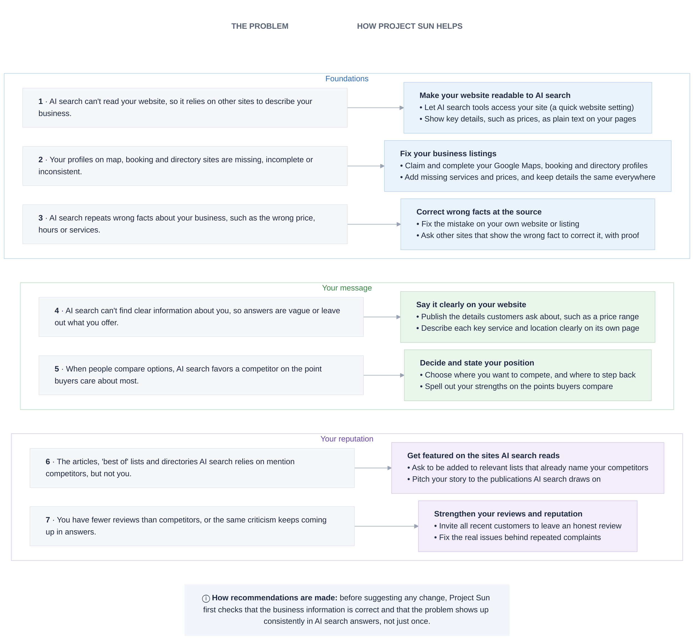

# From AI search problems to practical fixes

**Project Sun · Recommendations and actions.** Seven common reasons a business is overlooked or misrepresented in AI search, and how Project Sun helps fix each one.

Editable design: [Figma — Project Sun, Recommendations and Actions (simple map)](https://www.figma.com/design/zDO3bjz8IaPqtiBJwtGoK0)

